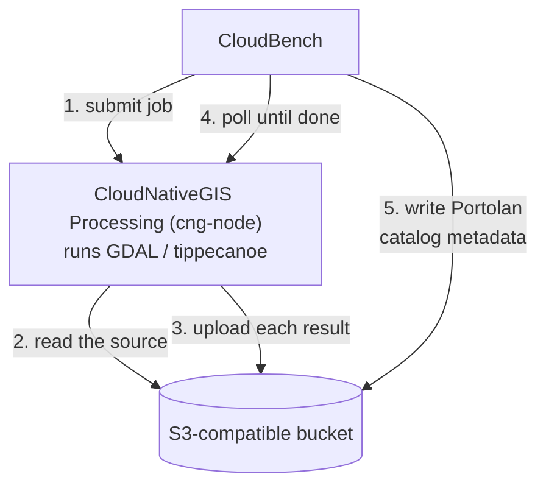
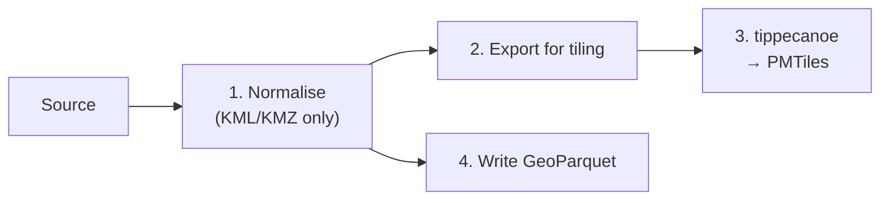

# CloudBench S3 conversion process

CloudBench (`kartoza-cloudbench`) converts files already sitting in an S3-compatible
bucket into web-ready layers, in the background: a user uploads nothing through their
browser, and may convert one file at a time or a whole folder at once ("bulk upload").
This page documents how that background conversion actually runs - the commands and
arguments involved - split into the two format families CloudBench converts, plus the
VRT CloudBench can build afterwards over a bulk upload's rasters.

Two separate codebases are involved:

- **CloudNativeGIS Processing** ("cng-node") - a small, database-free FastAPI
  service that does the actual conversion: it downloads (or reads from the same
  bucket) the source file, runs the GDAL/tippecanoe commands below, and uploads
  every result straight to the destination bucket itself, via a presigned URL per
  file.
- **CloudBench** - submits the conversion job to cng-node (one running on a fixed
  server, or one on-demand, per job, started on Hetzner Cloud), polls it to
  completion, and writes the Portolan catalog metadata once it's done. For a bulk
  upload, it also optionally builds a VRT of the batch's GeoTIFFs itself, directly
  with GDAL - no cng-node job for that.



### Tool versions

cng-node's image (`processing/Dockerfile`) pins these:

| Tool | Version | Source |
|---|---|---|
| GDAL (`gdal_translate`, `gdalwarp`, `gdalinfo`, `ogr2ogr`, `ogrmerge.py`) | **3.11.4** | `ghcr.io/osgeo/gdal:ubuntu-full-3.11.4` - the "full" build, needed for Arrow/(Geo)Parquet support |
| tippecanoe | *unpinned* - whatever's on `main` when the image is built | [`felt/tippecanoe`](https://github.com/felt/tippecanoe), **not** the original `mapbox/tippecanoe` - built from source, `git clone --depth 1` |
| PDAL (LAS/LAZ → COPC; not covered on this page) | 2.10 | conda-forge |

Nothing above a few hundred MB is ever downloaded to CloudBench's own disk: cng-node
reads the source and writes every result through presigned URLs, and the VRT step
below only ever reads a COG's *header*, not its pixels.

This page is about how the conversion itself runs. For what the files it produces
actually are and how to use them, see
[Consuming a converted layer](../administrator/consuming-converted-layers.md).

## Vector layers → PMTiles + GeoParquet

A shapefile (as a `.zip`), GeoPackage, GeoJSON, FlatGeobuf or KML/KMZ becomes a pair
of files per layer: a **GeoParquet** (the analysis-ready data, in the source's own
CRS) and a **PMTiles** (the web-map rendering) - the pairing the
[Portolan](https://github.com/portolan-sdi/portolan-spec) spec asks for.



Steps 2+3 and step 4 both only read the (normalised) source, so they run at the same
time, not one after the other - see step 4 below.

### 1. Normalise to one layer

A KML/KMZ with several `<Folder>`s is merged into one GeoPackage layer first (LIBKML
reads each folder as its own OGR layer, but GeoParquet holds exactly one), keeping
each feature's folder name in a `folder` column:

```bash
ogrmerge.py -single -f GPKG -o merged.gpkg \
  -nln merged \
  -lco GEOMETRY_NAME=geometry \
  -src_layer_field_name folder \
  -src_layer_field_content "{LAYER_NAME}" \
  <source>
```

A GeoPackage's own layers, and any other single-layer source, skip this step.

### 2. Export features for tiling

The layer is exported as line-delimited GeoJSON (`GeoJSONSeq`), reprojected to
WGS84 - the CRS tippecanoe tiles in:

```bash
ogr2ogr -f GeoJSONSeq [-s_srs EPSG:4326] -t_srs EPSG:4326 <output>.geojsonl <source> [<layer>]
```

`-s_srs EPSG:4326` is only added when the source has no coordinate system of its own
(e.g. a shapefile missing its `.prj`) - rather than failing the conversion, WGS84 is
assumed, since that's the common case.

### 3. Tile with tippecanoe to create the PMTiles

```bash
tippecanoe --force -P --projection=EPSG:4326 \
  --smallest-maximum-zoom-guess=<floor> \
  --no-simplification-of-shared-nodes \
  -o <output>.pmtiles -l <layer-name> <input>.geojsonl
```

| Flag | Why |
|---|---|
| `-P` | Reads the GeoJSONSeq input in parallel. |
| `--smallest-maximum-zoom-guess=<floor>` | tippecanoe's own `-zg` guesses a layer's max zoom from the *typical* spacing between features - a layer with both dense and sparse areas (e.g. a country's neighbourhoods: packed in cities, sparse elsewhere) can get dragged down to a low guess by its sparser areas, blowing up blocky tiles client-side exactly at the zoom someone's actually looking at. `--smallest-maximum-zoom-guess` is `-zg`'s own density-based guess with a floor: unlike plain `-zg` it never refuses to guess, so there's no separate fallback to handle. It never *lowers* a denser layer's own higher guess. The floor is `DEFAULT_MIN_MEANINGFUL_ZOOM` (9) unless the API request names a different `min_meaningful_zoom`. |
| `--no-simplification-of-shared-nodes` | Simplifies an edge shared between adjacent polygons (e.g. neighbouring admin boundaries) the same way on both sides, so low zoom doesn't show a gap or sliver along the shared border. |

tippecanoe's own stderr progress (`Maxzoom: NN%`, then `z/x/y NN.N%`) is parsed live and
relayed to CloudBench's polling as the job's progress message.

A timeout scales with input size - `300s` base, `+20min` per GB, capped at `3h` - so a
genuinely large layer gets the time it needs (2.8M buildings, 1.1GB, take ~3 minutes on
16 cores) while a pathological geometry (e.g. a near-global polygon forced to a high
zoom) can't run away forever.

### 4. Write the GeoParquet

Run alongside tippecanoe (both only read the source), not after it:

```bash
ogr2ogr -f Parquet \
  -lco COMPRESSION=ZSTD -lco WRITE_COVERING_BBOX=YES -lco ROW_GROUP_SIZE=100000 \
  [-a_srs EPSG:4326] \
  <output>.parquet <source> [<layer>]
```

This satisfies Portolan's GeoParquet requirements: GeoParquet 1.1, with a per-row-group
bbox-covering column, row groups capped at 150k rows (100,000 is used), and `zstd`
compression. The rows are then re-ordered along a spatial curve (not GDAL's own
`SORT_BY_BBOX`, which doesn't pack them tightly enough for Portolan).

## Raster (TIFF, or a GeoPackage's raster tables) → COG

A GeoTIFF, or a raster table inside a GeoPackage, becomes **two** Cloud Optimized
GeoTIFFs: the original-CRS one, and an `EPSG:3857` (Web Mercator) one.

The second variant exists purely for rendering. MapLibre's map canvas is Web
Mercator throughout, and `maplibre-cog-protocol` (the library Map Explorer uses to
add a COG as a map source) reads windows of the COG straight into MapLibre's WebGL
pipeline with no reprojection step - too slow to do per frame in the browser - so the
COG itself has to already be in `EPSG:3857`. That reprojection happens once, up
front, via `gdalwarp` below, instead of on every pan or zoom. The original-CRS COG is
kept alongside it for anything that measures the raster (see
[Consuming a converted layer](../administrator/consuming-converted-layers.md)) -
reprojecting first would distort that.

```bash
gdal_translate -of COG -co COMPRESS=DEFLATE -co BLOCKSIZE=512 -co STATISTICS=YES \
  <input>.tif <output>.tif

gdalwarp -t_srs EPSG:3857 -of COG -co COMPRESS=DEFLATE -co BLOCKSIZE=512 -co STATISTICS=YES \
  <input>.tif <output>_3857.tif
```

Both variants go through the same `COG_OPTIONS`. After each, `gdalinfo -json` (with
`GDAL_PAM_ENABLED=NO`, so it can't fall back to a sidecar `.aux.xml`) checks every band
actually carries its min/max/mean/stddev *embedded in the file itself* - if any are
missing, the conversion fails rather than publishing a COG a client would have to
compute statistics for itself. (Needs a GDAL build with `STATISTICS=YES` support for
the COG driver - GDAL ≥ 3.8.)

## Building a VRT (bulk upload only)

A bulk upload may also publish a GDAL VRT ("virtual raster") of its GeoTIFFs, once
every layer's COG conversion is done - a single mosaic-like overview over the whole
batch's rasters, without re-encoding any pixel. This step runs **in CloudBench
itself**, not in cng-node - see `apps/s3/bulk_vrt.py`.

### 1. Read each COG's header only

Rather than downloading every COG in full, only the start of each file is fetched -
enough for GDAL to read its header (its CRS, band count, data type, extent), not its
pixel data - via an HTTP range request against the bucket:

```
GET <cog-key>  Range: bytes=0-1048575
```

If `gdalinfo` can't parse that much (a very large raster's tile-offset arrays can run
long), it's retried with a bigger range - `16 MiB`, then `256 MiB` - stopping once a
read comes back shorter than asked for (the whole file, however small).

### 2. Group rasters that can share one VRT

Not every raster in a batch can go in the same VRT: a VRT's members must share a CRS,
band count and data type (not `nodata` - each source keeps its own in a VRT, unlike a
true mosaic's tiles). The **largest** such group is kept; anything that doesn't match
it is left out of the VRT, each with why (e.g. *"in EPSG:3857, not EPSG:32735"*,
*"2 band(s), not 1"*) - but every layer, in or out, is still published as its own COG
collection regardless.

### 3. Build the VRT

```bash
gdalbuildvrt -resolution highest <name>.vrt <relative-path-to-each-cog>...
```

Run with the batch's common parent folder as its working directory, and each COG
given as a path *relative* to that folder - `/vsicurl/` (reading straight from a URL)
doesn't resolve a `../` the way a local path would, so every path in the VRT must run
*down* from where the VRT itself sits, never up and back down.

## See also

- [Consuming a converted layer](../administrator/consuming-converted-layers.md) - what
  the files these conversions produce actually are, and how to use each one.
- `apps/s3/cng_lite.py` in `kartoza-cloudbench` - how a job's steps (provision, push,
  poll, verify, publish) are driven from the CloudBench side.
